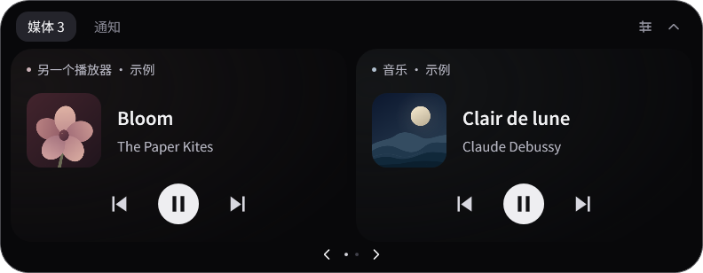
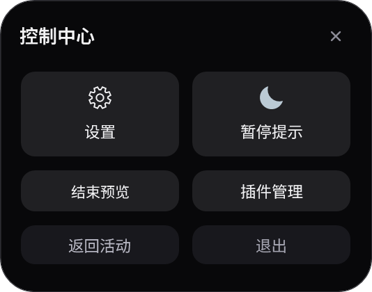
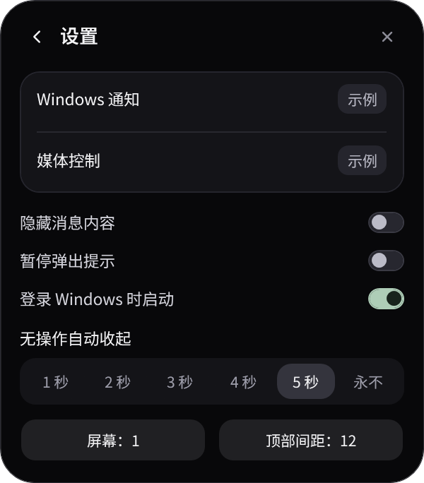
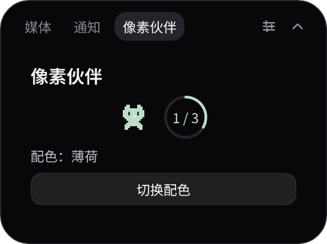
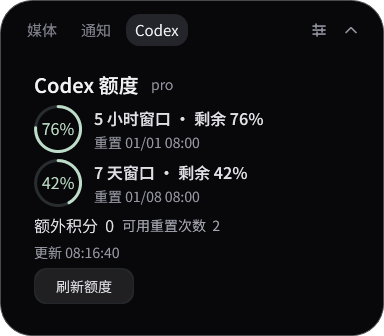

<p align="center">
  
</p>

<h1 align="center">LandBar</h1>

<p align="center">Windows 顶部的通知、媒体与自定义活动</p>

<p align="center">
  <a href="https://github.com/LeoAndJellyfish/LandBar/actions/workflows/ci.yml"></a>
  <a href="https://github.com/LeoAndJellyfish/LandBar/releases/latest"></a>
</p>

<p align="center">
  <a href="https://github.com/LeoAndJellyfish/LandBar/releases/latest">下载 Windows x64 版</a> ·
  <a href="docs/installation.md">安装说明</a> ·
  <a href="docs/plugins.md">插件开发</a> ·
  <a href="docs/development.md">开发与构建</a>
</p>

<p align="center">
  
</p>

LandBar 在桌面顶部显示一个紧凑胶囊。空闲时显示居中时钟，也可通过插件添加像素动画、圆环或替换整个收起态。媒体来源、曲目与播放状态变化在收起态同步；新通知和插件活动可展开提示。单击可查看媒体、通知及各插件的独立标签，右键进入控制中心。深色圆角界面搭配 Noto Sans SC 字体，展开与收起围绕顶部中心过渡，文字保持原始大小。

<p align="center"></p>

## 开始使用

适用于 **Windows 10 2004（19041）及以上版本、Windows 11，x64**。发布包自带 .NET 运行环境。

当前公开版本采用**未签名的开发身份包**，首次安装需要手动开启 Windows 开发者模式。

1. 从 [Releases](https://github.com/LeoAndJellyfish/LandBar/releases/latest) 下载 Windows x64 ZIP，完整解压至固定目录。
2. 在 Windows 设置中搜索并手动开启“开发者模式”。
3. 双击解压目录中的 `安装并启动.cmd`，完成应用身份注册并启动。
4. 右键灵动岛或单击托盘中的 **LandBar**，进入“控制中心 → 设置”，按页面提示授予通知访问权限。

以后双击 `启动.cmd` 即可运行。更新、卸载、签名包和常见问题见 [安装说明](docs/installation.md)。

## 日常操作

| 操作 | 结果 |
| --- | --- |
| 单击胶囊 | 展开媒体、通知及插件各自的标签页 |
| 右键胶囊／单击托盘图标 | 打开控制中心，进入设置或预览 |
| 点击上一首、播放／暂停、下一首 | 控制对应媒体来源，其他来源保持原状态 |
| 点击分页箭头／滚动滚轮 | 查看更多媒体或通知 |
| 通知页点击“清空消息” | 清理岛内通知历史和待展示消息，保留媒体 |
| 点击收起按钮／按 Esc | 收起面板 |

两个媒体来源可以并列显示，暂停的来源也可继续查看。通知和插件活动的自动提示最多并列两条，更多提示每 **4 秒**轮换；悬停时暂停轮换。

设置页可选择 **1–5 秒无操作后收起**或**永不收起**，默认 5 秒。鼠标位于灵动岛实际可见范围内时暂停收起，移出后重新计算完整时长。点击、滚动、键盘输入与新提示会重新计时。设置中还可隐藏消息内容、暂停弹出提示、启用登录启动，以及调整显示器和顶部间距。

<details>
<summary>查看控制中心与设置</summary>

<p>
  
  
</p>

</details>

## 插件

插件支持独立命名标签、页面替换与收起态组件。插件可使用布局、文字、按钮、圆环和像素帧描述界面，也可继续提交活动卡片。宿主负责排版、动画和生命周期；插件停用后，相关界面与标签撤回，页面恢复内置显示。**v0.6.0** 增加左右侧位置声明和 Codex 额度示例。

<p align="center">
  
</p>
<p align="center">
  
</p>

| 示例 | 功能 | 依赖 |
| --- | --- | --- |
| 专注计时 | 倒计时、暂停、继续和重置 | Windows PowerShell 5.1 |
| 像素伙伴 | 左右侧像素动画、独立标签和配色切换 | Windows PowerShell 5.1 |
| [Codex 额度](https://github.com/LeoAndJellyfish/LandBar/blob/main/samples/codex-balance/README.md) | 套餐剩余额度、重置时间、额外积分和侧边圆环 | Python 3.10+、Codex CLI、ChatGPT 登录 |

<p align="center">
  
</p>

1. 打开“控制中心 → 插件管理”，选择需要的示例，安装后手动启用。
2. 插件的独立标签自动出现。Codex 示例读取当前使用者本机 Codex CLI 返回的额度信息；先完成示例文档中的环境检查。
3. 在“界面与空闲插槽”中为收起态组件选择“左侧”或“右侧”；固定侧边按插件声明显示。页面替换点击“使用”。
4. 点击已选中的侧别移除组件；页面替换点击“还原”。托盘菜单的“恢复内置界面”可停用全部界面替换。

自行开发时，在 `%LOCALAPPDATA%\LandBar\Plugins\<插件目录>` 放置 `plugin.json` 和程序，再刷新插件列表。侧边组件必须声明默认位置与允许的侧边；像素伙伴示例支持左右切换，宿主统一处理组件间距和主体居中。协议采用 UTF-8 JSON Lines，可使用 C#、Python、PowerShell 等语言。插件默认停用，以当前用户权限运行；请仅启用信任的本地程序。清单、协议、生命周期、示例与设计依据见 [插件开发文档](docs/plugins.md)。

从旧版更新侧边插件时，须补齐 `placement` 声明。已安装的示例保存在用户插件目录中，更新 LandBar 后按 [迁移说明](docs/plugins.md#旧版侧边插件迁移)替换示例源码。发布包包含通用源码，用户登录凭据、额度快照和本机配置留在用户电脑。

## 接入范围

通知来自 **Windows 通知中心**，媒体来自 **Windows 系统媒体会话**。应用提供的通知内容、媒体信息和控制能力决定岛内可显示及操作的内容。

- **系统通知**：接收应用提交给 Windows 通知中心的新消息；历史保存在进程内，退出后清空。
- **系统媒体**：展示接入系统媒体控制的播放器与浏览器，支持独立会话和播放状态同步。
- **微信正文**：当前尚无独立接入。任务栏红点、闪烁和提示音属于其他提醒渠道，相关正文仍需单独适配。QQ 等应用也以其实际系统通知输出为准。
- **内置预览**：使用明确标注“示例”的通知和媒体，与真实通知队列分离；结束预览后恢复实际来源。
- **插件活动**：来源由用户安装的程序提供，支持进度、按钮和主动撤回；同一卡片更新保留展示期限，收起后可在对应插件的独立标签继续查看。

显示设置存于 `%LOCALAPPDATA%\LandBar\settings.json`，封面缓存位于同目录的 `Artwork` 文件夹。通知正文保存在内存中，诊断日志记录异常类型。

## 开发

项目使用 **C#、WPF 与 .NET 10**。构建和测试需要 Windows；身份包构建还需要 Windows SDK 中的 MakeAppx。

```powershell
git clone https://github.com/LeoAndJellyfish/LandBar.git
cd LandBar
dotnet build src/LandBar/LandBar.csproj -c Release
./scripts/Test.ps1
```

CI 检查核心逻辑、插件协议与真实子进程、媒体选择、封面缓存、动画数学、配色、字体资源及构建。依赖交互桌面的窗口、置顶与系统媒体测试单独运行。打包流程、测试分类和发布约定见 [开发文档](docs/development.md)。

问题反馈可提交到 [Issues](https://github.com/LeoAndJellyfish/LandBar/issues)，请注明 Windows 版本、LandBar 版本、来源应用及复现步骤。字体与运行时的分发声明见 [第三方声明](THIRD_PARTY_NOTICES.md)。
